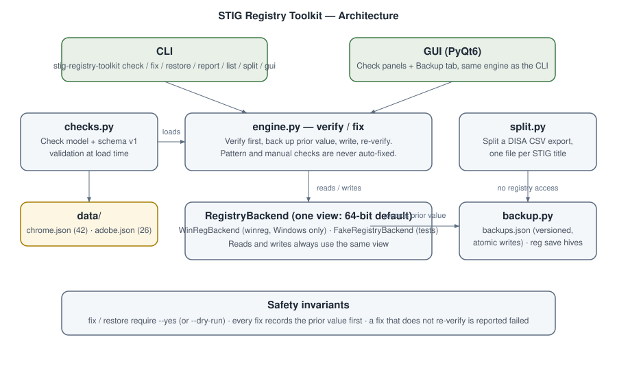

# STIG Registry Toolkit

[](https://github.com/enonymous1/stig-registry-toolkit/actions)

## Description

STIG Registry Toolkit checks a Windows machine against DISA STIG registry settings, and fixes what fails, with the prior value backed up first.

It verifies Google Chrome (42 checks) and Adobe Acrobat Reader DC (26 checks) registry policies against their STIG expectations, shows what fails and why, and applies fixes only when you confirm. Every fix records the old value before writing, re-verifies after writing, and can be undone with one command. Results are never baked into the data files: status is computed live, every run, so a report always describes *this* machine, right now.

It also ships `split`, a prep tool that turns a concatenated DISA STIG CSV export back into one CSV per STIG title, which is how the bundled Chrome and Adobe check data was originally prepared.

## Architecture



The CLI and the PyQt6 GUI are thin fronts over one engine. `engine.py` verifies and fixes; `checks.py` loads and validates the bundled JSON data; `registry.py` hides Windows `winreg` behind a backend interface (with an in-memory fake backend the test suite runs against); `backup.py` owns per-value backups and `reg save` hive backups. `split.py` is standalone and never touches the registry.

## Prerequisites

- **Windows 10 or 11** for registry operations (`check`, `fix`, `restore`, `backup`, and the GUI's verify/fix actions). On Linux or macOS those commands report that the registry is unavailable instead of pretending to run; `list`, `report` against bundled data, and `split` still work.
- **Python 3.10, 3.11, or 3.12.**
- **Administrator rights** on Windows to apply fixes or back up hives. Verification works without elevation.
- **PyQt6** for the GUI only (the `gui` extra). The CLI core has no third-party dependencies.
- For contributors running the GUI import test on Linux: the Qt system libraries (`libegl1`, `libgl1`, `libxkbcommon0`, `libdbus-1-3`, `libfontconfig1`). CI installs these on Ubuntu runners; see [Local Development](#local-development).

## Installation

This package is not published to PyPI yet. Install it from a clone:

```powershell
git clone https://github.com/enonymous1/stig-registry-toolkit.git
cd stig-registry-toolkit
python -m venv .venv
.\.venv\Scripts\activate
pip install ".[gui]"     # CLI + GUI
```

For the CLI only, omit the extra:

```powershell
pip install .
```

## Quick start (Windows, PowerShell, as Administrator)

```powershell
stig-registry-toolkit check                    # verify everything, no changes
stig-registry-toolkit fix --dry-run            # preview what would change
stig-registry-toolkit fix --yes                # apply fixes, backing up prior values
stig-registry-toolkit restore --yes            # undo the last fixes from their backups
stig-registry-toolkit gui                      # graphical interface
```

## How fixes stay safe

- **Confirm first.** `fix` and `restore` refuse to change the registry without `--yes`. `--dry-run` previews without touching anything.
- **Back up first.** Each fix writes the current value (or its absence) to `stig-registry-toolkit-backups/backups.json` before changing it. `stig-registry-toolkit restore --yes` puts those values back. The backup file is versioned and written atomically, so an interrupted run cannot leave a half-written store.
- **Re-verify after.** A fix that doesn't re-verify as passing is reported as failed, not as applied.
- **No silent skips.** Manual checks (3 of the 68) and pattern checks (one Chrome check requires a URL matching `^https`) are never auto-fixed; they say so and tell you what to set by hand. A dry run counts only checks a real run would actually write.
- **One registry view.** Reads and writes both use the 64-bit view by default (`--view 32` to change it), so a check can't read one view and fix another.
- **Whole-hive safety net.** `stig-registry-toolkit backup` saves SYSTEM, SOFTWARE, and CURRENT_USER with `reg save`. Restoring a whole hive is a `reg restore` from an elevated prompt; per-value restore is the normal undo path.

## CLI

```powershell
stig-registry-toolkit list --app chrome
stig-registry-toolkit check --app adobe --format json
stig-registry-toolkit check --app chrome --format csv > chrome-report.csv
stig-registry-toolkit report --format json --output report.json
stig-registry-toolkit fix --app chrome --check-id V-221558 --yes
stig-registry-toolkit fix --app all --dry-run
stig-registry-toolkit backup --dir C:\backups\stig-registry-toolkit
stig-registry-toolkit restore --app chrome --yes
stig-registry-toolkit split all_stigs.csv --dry-run
stig-registry-toolkit split all_stigs.csv --output-dir C:\stigs\split
```

Exit codes: `check`/`report` return 0 when nothing fails, 1 when checks fail or error, 2 for usage and platform errors. `fix` returns 1 when any fix fails. `split` returns 0 on success and 2 for a missing file, a missing column, malformed CSV, or existing outputs without `--overwrite`. Filesystem failures (for example, an unwritable report path) fail with a clean error message and exit code 1, not a traceback.

## Splitting a DISA export

DISA ships STIGs as one concatenated CSV holding every benchmark. `split` turns it back into one CSV per STIG title, which is how the bundled Chrome/Adobe check data was originally prepared. It writes CSVs only; it does not convert a split file into the JSON check schema. Bring your own current export (the bundled checks have not been re-exported against current benchmarks; see below), and keep the export out of git: it is tens of megabytes and goes stale.

```powershell
stig-registry-toolkit split all_stigs.csv --dry-run   # preview: files + row counts, writes nothing
stig-registry-toolkit split all_stigs.csv            # writes all_stigs_split\*.csv next to the input
```

Each output keeps the original header and rows for one title. Titles that sanitize to the same filename get distinct names (`A/B.csv` and `A_B__2.csv`), blank titles are skipped and counted, and an existing output file blocks the run unless you pass `--overwrite`. Input is read as UTF-8 with an optional byte-order mark, so exports saved from Windows tools split without a spurious "missing column" error.

## GUI

`stig-registry-toolkit gui` (or `python -m stig_registry_toolkit` with no arguments) opens three tabs: Backup & Restore, Google Chrome, and Adobe Acrobat Reader DC. Each check panel verifies on load, lets you fix one issue or all failing issues after a confirmation dialog, and restores the selected check from its backup. The GUI uses the same engine as the CLI; it needs PyQt6 and Windows for registry operations, and shows the check data read-only elsewhere.

## The check data

Bundled data lives in `src/stig_registry_toolkit/data/` (`chrome.json`, `adobe.json`), one JSON file per app in a single schema: id, title, severity, test type, description, fix text, and a registry target (hive, path, value name, type, expected value) or a regex pattern. Expected values may be a list, meaning any listed value passes.

The data was converted from the 1.x tool's bundled files into that one schema. Two details from the conversion are worth knowing: the 1.x Chrome JSON used different field names than the panel expected, which is why 1.x Chrome enforcement never ran, and the 1.x Adobe file shipped with `Pass (Verified)` results from another machine, which v2 deliberately drops. The old duplicate constants file is gone. The STIG text itself is unchanged from the 1.x bundle; **re-verify the checks against the current DISA STIG benchmarks before relying on them for compliance**, as benchmarks are updated regularly and this bundle has not been re-exported.

To use your own data, point `--data-dir` at a directory with `chrome.json`/`adobe.json` in the same schema (schema version 1). Unknown fields, bad regexes, and missing registry targets fail loudly at load time.

## Local Development

```powershell
git clone https://github.com/enonymous1/stig-registry-toolkit.git
cd stig-registry-toolkit
python -m venv .venv
.\.venv\Scripts\activate
pip install ".[dev]"      # gates first, without the GUI extra
ruff check src tests
ruff format --check src tests
mypy --follow-imports=silent src/stig_registry_toolkit/checks.py src/stig_registry_toolkit/registry.py src/stig_registry_toolkit/engine.py src/stig_registry_toolkit/backup.py src/stig_registry_toolkit/cli.py src/stig_registry_toolkit/split.py
pytest -q
pip install ".[gui]"      # only now, for the GUI smoke test
python -c "import stig_registry_toolkit.gui"
```

Install the GUI extra after the gates on purpose: PyQt6 6.12.0's bundled type stubs are not parseable by mypy, so the type check runs before PyQt6 is present (CI does the same split). Tests run against an in-memory fake registry, so the full suite passes on Linux and macOS. The version lives in exactly one place, `src/stig_registry_toolkit/__init__.py`; the package metadata reads it from there, so a release never has to change the version twice.

A real Windows run is still the gate for registry behavior: launch the GUI, verify Chrome from a clean state, fix one failing check, and restore it. CI runs the same gates on Ubuntu and Windows.

## Deployment

CI runs on every push to `main` and every pull request, on Ubuntu and Windows across Python 3.10–3.12. A green main is the deployable state; there is no separate staging environment and no PyPI publishing configured yet.

To cut a release:

1. Bump the version in `src/stig_registry_toolkit/__init__.py` (the single source of truth).
2. Add a CHANGELOG entry describing the release.
3. Commit, then tag the release (`git tag vX.Y.Z`) and push the tag.
4. Publish the release notes on GitHub from the tag.

## Layout

```text
src/stig_registry_toolkit/
  checks.py    Check model, schema validation, bundled data loading
  registry.py  winreg backend (one view) + in-memory fake for tests
  engine.py    Verify / fix, with re-verification
  backup.py    Per-value backups, restore, reg save hive backup
  cli.py       check / fix / backup / restore / report / list / gui / split
  split.py     Split a concatenated DISA STIG CSV, one file per title
  gui.py       PyQt6 interface over the same engine
  data/        chrome.json (42 checks), adobe.json (26 checks)
docs/assets/
  architecture.svg  Module diagram (shown above)
tests/         pytest suite, fake registry only
```

## License

MIT. See [LICENSE](LICENSE).

## Disclaimer

This tool modifies the Windows Registry. Keep a full system backup before applying wholesale changes, and review `--dry-run` output first. STIG Registry Toolkit is not affiliated with DISA, Google, or Adobe.
